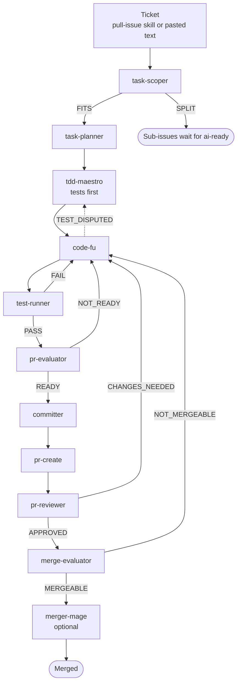

# agentic-engineering-workflow

Project-agnostic SDLC agents and skills that carry a ticket, from a GitHub issue or pasted text, to a merged pull request: planning, with large tasks split into sub-issues; test-driven implementation; review; and an optional final check and merge.

## What it does

A ticket comes in as a GitHub issue or as pasted text. Eleven agents, each with one task, take it through:

1. **Intake.** The `pull-issue` skill picks an issue, or the ticket is pasted.
2. **Scoping.** `task-scoper` decides whether the task is too large and splits it into sub-issues if so.
3. **Planning.** `task-planner` plans one right-sized task.
4. **Tests first.** `tdd-maestro` writes the failing tests.
5. **Coding.** `code-fu` writes the code that passes them.
6. **Testing.** `test-runner` runs the tests and reports.
7. **Readiness.** `pr-evaluator` decides whether the work is ready for a pull request.
8. **Commit.** `committer` makes the one commit for the ticket.
9. **Pull request.** `pr-create` pushes the branch and opens the pull request.
10. **Review.** `pr-reviewer` reviews it.
11. **Merge check.** `merge-evaluator` decides whether it can be merged.
12. **Merge.** `merger-mage` merges it. This stage is optional.

Any agent can also stop with `BLOCKED` or `NEEDS_USER`. Agents pass reports to each other as files, and lessons from earlier runs come from memory.

## Flow

## Documents

- `docs/agents.md`: the agents, each with its own doc in `docs/agents/`.
- `docs/rules.md`, `docs/abort-criteria.md`, `docs/user-input-criteria.md`: what holds for every agent.
- `docs/verdicts.md`: the verdicts agents return.
- `docs/reports.md`: the report each agent writes and reads in a run.
- `docs/memory.md`: the engram memory that carries lessons between runs.
- `docs/hooks.md`: the hook that enforces file and command limits.
- `docs/skills.md`: the skills, with `docs/skills/` for `pull-issue`, `tdd` and `pr-handoff`.
- `docs/issues.md`: the rules for the issues the workflow works on.
- `docs/config.md`: `agentic.toml` and its settings.
