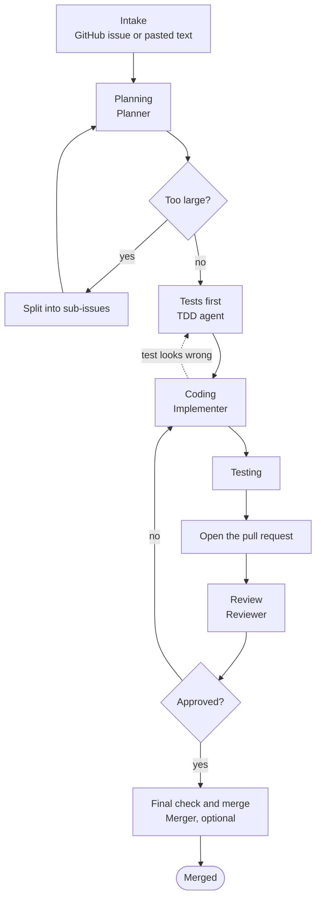

# agentic-engineering-workflow

Project-agnostic SDLC agents and skills that carry a ticket to a merged pull request.

## What it does

A ticket comes in as a GitHub issue or as pasted text. The workflow takes it through:

1. **Intake.** The ticket is read from the issue or from the pasted text.
2. **Planning.** The task is planned.
3. **Splitting.** A task that is too large is split into sub-issues, and each sub-issue is planned in turn.
4. **Tests first.** The TDD agent writes the tests that define the task before any code.
5. **Coding.** The Implementer writes the code that passes those tests.
6. **Testing.** The full test suite is run.
7. **Pull request review.** A reviewer agent reads the pull request.
8. **Final check and merge.** An optional agent makes the last checks and merges.

It is built from agents and skills, and it does not assume any one project.

## Flow

