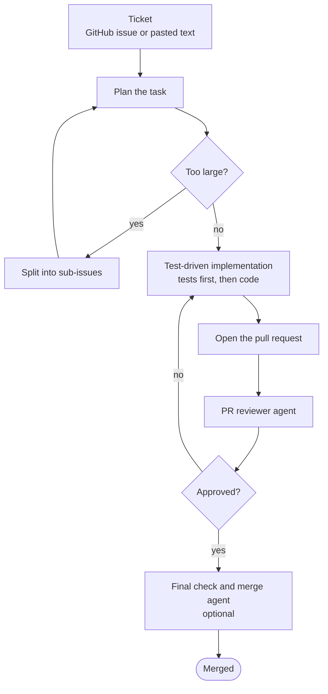

# agentic-engineering-workflow

Project-agnostic SDLC agents and skills that carry a ticket to a merged pull request.

This is an early design. The agents and skills are not written yet.

## What it does

A ticket comes in as a GitHub issue or as pasted text. The workflow takes it through:

1. **Planning.** A task that is too large is split into sub-issues, and each sub-issue is planned in turn.
2. **Test-driven implementation.** Tests are written first, then the code that passes them.
3. **Pull request review.** A reviewer agent reads the pull request.
4. **Final check and merge.** An optional agent makes the last checks and merges.

It is built from agents and skills, and it does not assume any one project.

## Flow

